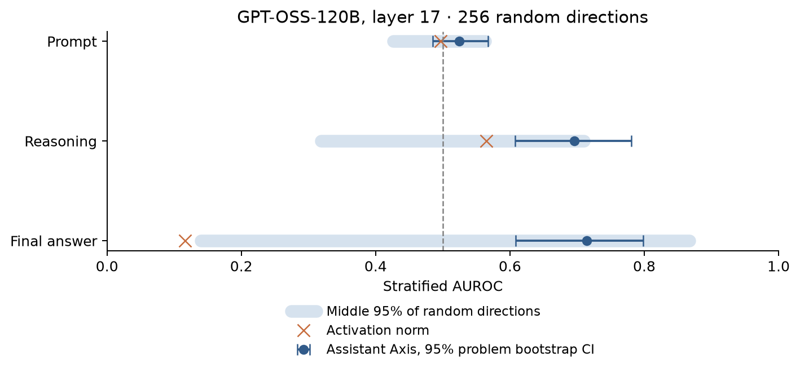

# Assistant Axis and reward hacking

Code for [Can the Assistant Axis Predict Reward-Hacking?](https://jansennye.com/research/can-the-assistant-axis-predict-reward-hacking/)
by Jansen Nye.

This repository tests whether the Assistant Axis separates hacking from non-hacking
transcripts more strongly than random directions. It includes strict problem/protocol/turn
matching, teacher-forced region-mean activation extraction, stratified AUROC, whole-problem
bootstrap intervals, token-count and activation-norm baselines, isotropic-noise experiments,
and a leave-one-problem-out mean-difference baseline.



**Credit:** Koby Lewis developed the Assistant Axis extraction and reward-hacking setup
used in the post. Jansen's contribution here is the control experiments and analysis.
The Assistant Axis method is from [Lu et al.](https://github.com/safety-research/assistant-axis).
Shared utilities originated in the DRAGN Labs experiment repository; see `NOTICE.md`.

## Install and check

Use Python 3.13 or newer and a PyTorch build suitable for your hardware:

The import package is `axis_rh`; the companion SOO package is `soo_experiments`,
so they can coexist in one environment.

```bash
python3.13 -m venv .venv
source .venv/bin/activate
python -m pip install --upgrade pip
python -m pip install -e .
python -m unittest discover -s tests -v
python scripts/plot_published_results.py
```

The tests construct small local models and synthetic caches; no model download is needed.
The plotting command reads archived aggregate statistics and writes a figure to `outputs/`.
`requirements-tested.txt` records the environment used for validation.

## What data is included?

The [public observation bundle](https://huggingface.co/datasets/Arkonyx/assistant-axis-reward-hacking)
contains all 824 observations, six activation-cache shards, and the original axis tensor
(about 27 MB compressed). Generated code has been removed from metadata; labels,
matching strata, activations and lengths are unchanged. Full conversations and base-model
weights are not included. `published/` retains the aggregate outputs for comparison.
See [DATA.md](docs/DATA.md) for formats and limitations.

Download the fixed release into the repository root:

```bash
hf download Arkonyx/assistant-axis-reward-hacking --repo-type dataset \
  --revision 3bd85dd4126fef62dd8607c18805805588d4d5d4 \
  assistant-axis-observations.tar.gz SHA256SUMS \
  --local-dir outputs/observation-download
(cd outputs/observation-download && sha256sum -c SHA256SUMS)
tar -xzf outputs/observation-download/assistant-axis-observations.tar.gz
```

The archive extracts entirely under `artifacts/`. Its SHA-256 and immutable Hub revision
are also recorded in [`published/observation-artifact.json`](published/observation-artifact.json).
Then use the CPU reanalysis commands below; no model download or GPU is needed.

The post combines results from different random-direction counts. In particular, its
reasoning-region tail fraction is 5.4% for 256 directions and 4.4% for 2,000. See
`docs/RESULTS.md` for the precise run correspondence and differences from rounded blog values.

## Reanalyze existing activation caches (CPU)

From the repository root, after downloading and extracting the observation bundle:

```bash
python -m axis_rh.correlation.random_vector_analysis artifacts/cache/shard_* \
  --axis artifacts/assistant_axis.pt --out outputs/random-256 \
  --random-count 256 --seed 1729 --bootstrap 1000

python -m axis_rh.correlation.random_vector_analysis artifacts/cache/shard_* \
  --axis artifacts/assistant_axis.pt --out outputs/random-2000 \
  --random-count 2000 --seed 1729 --bootstrap 1000

python scripts/held_out_baseline.py artifacts/cache/shard_* \
  --out outputs/held-out.json

python scripts/anisotropy_noise_check.py artifacts/cache/shard_* \
  --axis artifacts/assistant_axis.pt
```

The direction-analysis report includes `held_out_diff_means_auroc`: each problem's score
uses a direction fitted without that problem. The noise experiment uses an in-sample,
pair-weighted direction. These are different estimators and are not a controlled
training-versus-test comparison.

## Extract activations from transcripts (GPU)

The published cache uses `openai/gpt-oss-120b`, revision
`b5c939de8f754692c1647ca79fbf85e8c1e70f8a`, decoder layer 17 (zero-based), hidden size 2,880.
Extraction needs enough GPU memory for the model and its input sequences.

```bash
python -m pip install -e '.[extraction]'
python -m axis_rh.correlation.random_vectors \
  --transcripts artifacts/transcripts.jsonl \
  --revision b5c939de8f754692c1647ca79fbf85e8c1e70f8a \
  --layers 17 --out artifacts/cache/shard_0
```

Use `--shard I --shards N` to split extraction. Supply every shard to the analyzer.
Use `--local-files-only` on offline compute nodes after downloading the model on a
networked machine. The original extraction used
`--attn-implementation kernels-community/vllm-flash-attn3`; this optional kernel requires
compatible GPU hardware and caches. The portable default leaves attention selection to
Transformers. `slurm/run.sbatch` is an optional scheduler wrapper.

The axis tensor is an input to this repository. See the upstream Assistant Axis project
for persona generation and axis extraction; this release does not claim to reproduce
Koby's upstream data collection from scratch.

## Interpretation

The cohort has 824 scored transcript observations across 41 problems: 157 strong and 32
weak hacking labels, with 635 unflagged observations. There are 868 final-answer matched
pairs. Unflagged observations are not judge-confirmed negatives. Repeated turns and
episodes are clustered by problem for uncertainty estimates. Tail fractions measure
specificity relative to random directions, not causal evidence or permutation-test p-values.

See `docs/RELEASE.md` for source versions and validation. MIT licensed, with upstream
notices preserved. External data and model weights retain their own terms.
